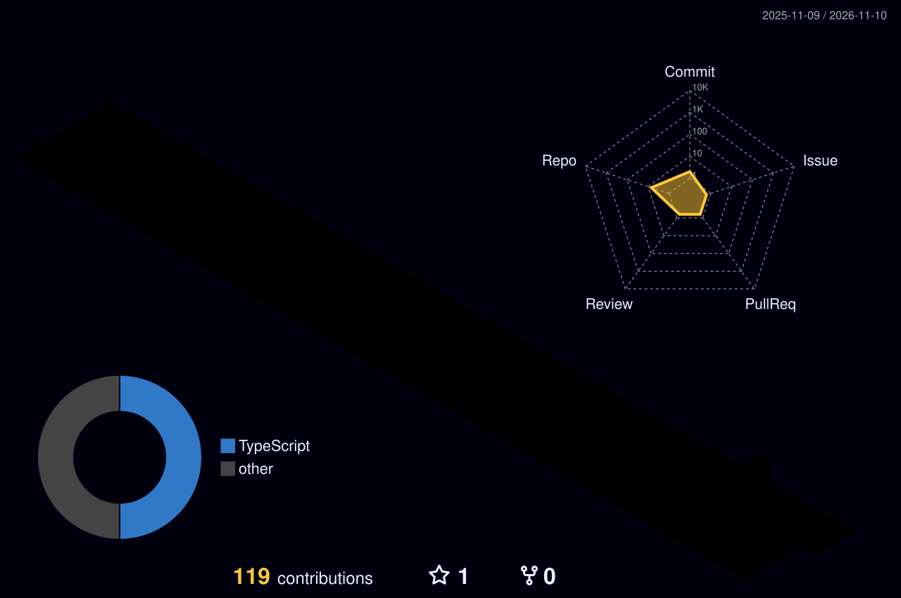

# Alex

FiveM systems engineer. Lua and TypeScript — server-side systems, in-game interfaces.

Qbox &nbsp;·&nbsp; ox_inventory &nbsp;·&nbsp; ox_lib

 

 

 

 

<picture>
  <source media="(prefers-color-scheme: dark)" srcset="https://streak-stats.demolab.com?user=AlexWangOlu&hide_border=true&background=0D1117&stroke=30363D&ring=58A6FF&fire=58A6FF&currStreakLabel=58A6FF&sideLabels=C9D1D9&dates=8B949E&currStreakNum=C9D1D9&sideNums=C9D1D9" />
  
</picture>

 

